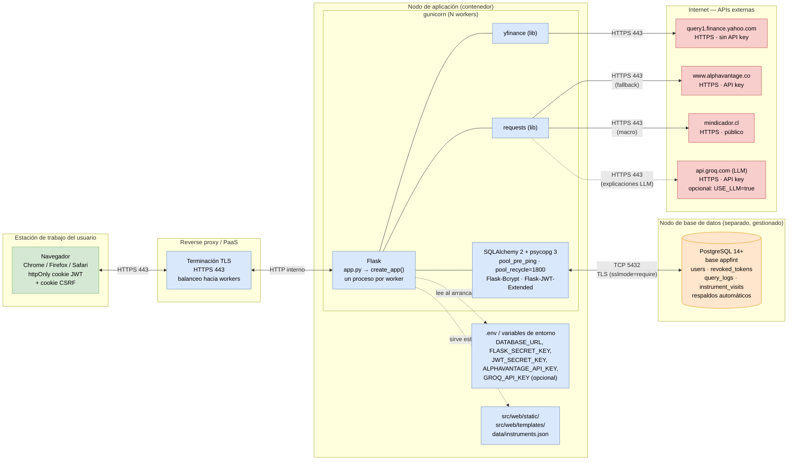

# Diagrama de despliegue — appfint

**Escenario de producción**: el navegador del usuario accede por HTTPS a un reverse proxy / PaaS que termina TLS y reenvía las peticiones a varios workers de **gunicorn**, cada uno ejecutando la aplicación Flask. La base de datos es un **nodo PostgreSQL separado** (servicio gestionado, por ejemplo Neon, Supabase o Render) al que los workers se conectan por TCP 5432 con TLS (`sslmode=require`). Los datos persisten aunque el contenedor de la aplicación se destruya y se recree en cada despliegue.

**Escenario de desarrollo**: el mismo esquema, pero con `python app.py` (servidor de desarrollo de Flask en `127.0.0.1:5001`) y un PostgreSQL local instalado con Homebrew (base `appfint`; las pruebas usan la base `appfint_test`).

Este diagrama muestra los **nodos físicos** (máquinas y procesos) y las **conexiones de red reales** que ocurren en ejecución.

## Características del despliegue

| Aspecto | Valor | Comentario |
|---|---|---|
| Servidor de aplicaciones | gunicorn con varios workers (producción); `python app.py` en desarrollo | El servidor de desarrollo de Werkzeug no se usa en producción. |
| Terminación TLS | Reverse proxy / PaaS (HTTPS 443) | Permite `JWT_COOKIE_SECURE=true` (cookies solo por HTTPS). |
| Puerto de la app | 5001 en desarrollo (definido en `app.py`); en producción lo define gunicorn / el PaaS | El proxy reenvía por la red interna. |
| Base de datos | PostgreSQL 14+ en nodo separado, accedido con SQLAlchemy 2 + psycopg 3 (`postgresql+psycopg://`) | `DATABASE_URL` es obligatoria; las URLs `postgres://` de los PaaS se normalizan. |
| Conexión a la BD | TCP 5432 con TLS (`sslmode=require`) | Pool con `pool_pre_ping=True` y `pool_recycle=1800` para tolerar conexiones cerradas por el servicio gestionado. |
| Esquema | Migraciones Alembic (`flask db upgrade` aplica `0001_esquema_inicial`) | No se crean tablas al arrancar la app. Se ejecuta en cada despliegue. |
| Concurrencia en BD | MVCC de PostgreSQL con varios workers escribiendo en paralelo | Las restricciones únicas las garantiza el motor; la app tolera `IntegrityError` en carreras. |
| Persistencia y respaldos | Datos fuera del contenedor; respaldos automáticos y recuperación a un punto en el tiempo del servicio gestionado | Redesplegar la app no afecta los datos. |
| Autenticación | JWT en cookie httpOnly + CSRF token en cookie legible por JS | Ver `config.py`. Cookie `Secure` activa por defecto. |
| Caché | En memoria de cada worker (`TTLCache`, 5 min) | Se pierde al reiniciar y no se comparte entre workers. |
| Secretos | Variables de entorno (`.env` solo en desarrollo, no versionado) | `python-dotenv` las carga en `Config`; en producción las entrega el PaaS. |
| Fuentes externas | Yahoo (primaria), Alpha Vantage (fallback), mindicador.cl (macro), Groq (LLM, opcional) | Todas por HTTPS 443; el LLM se activa con `USE_LLM=true` y degrada a plantillas si falla. |

## Evolución prevista (fuera del alcance actual)

Anotado como referencia si el proyecto crece:

- **Cache compartida** (Redis) para que todos los workers e instancias vean la misma caché de precios: `TTLCache` en memoria es por proceso.
- **Pooler de conexiones** (PgBouncer) y réplicas de lectura si aumenta el número de instancias de la aplicación.
- **Secretos** en un gestor dedicado del proveedor (AWS Secrets Manager, etc.).
- **Observabilidad**: log estructurado + métricas (Prometheus) + tracing (los `processing_time_ms` que ya se escriben en `query_logs` son la base).
